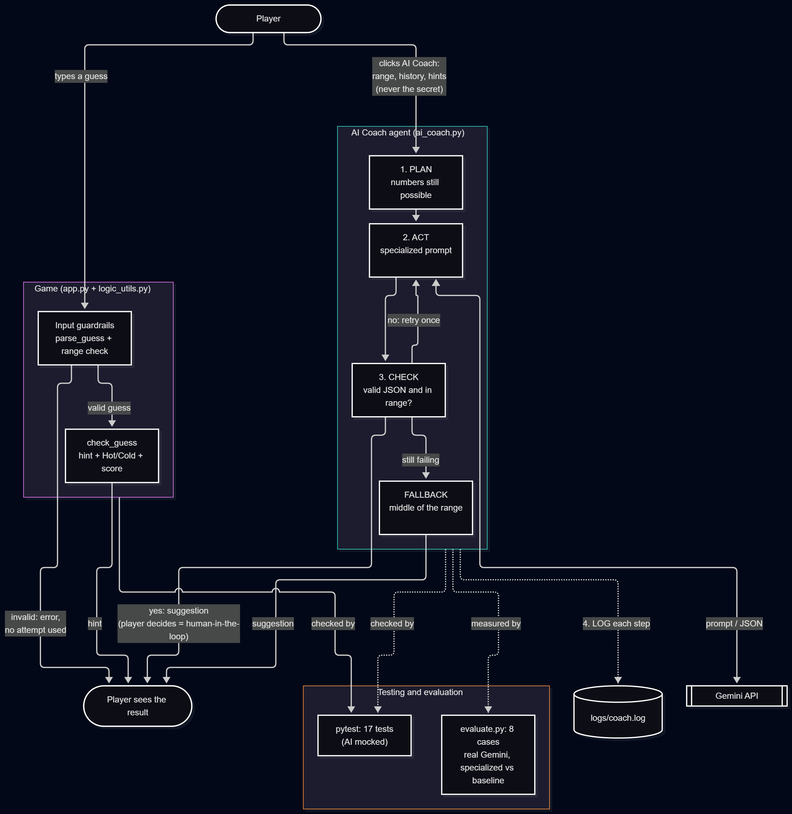

# 🎮 Game Glitch Investigator + AI Coach

A Streamlit number-guessing game with a built-in **AI Coach**: an agent that
plans, asks Google Gemini for the next guess, checks the answer with
guardrails, and logs every step. The player decides whether to follow it.

## Base Project

This project extends **Game Glitch Investigator** (Module 1,
[original repo](https://github.com/adiilkariim/ai110-module1show-gameglitchinvestigator-starter)).
It started as a Streamlit number-guessing game that an AI wrote full of bugs:
the player guesses a secret number within a difficulty's range (Easy 1-20,
Normal 1-100, Hard 1-50) and a limited number of attempts, getting
"Go Higher / Go Lower" hints and a score. In Module 1, I found and fixed 8 bugs
(inverted hints, wrong attempt count, broken New Game, unchecked input), moved
the game logic into `logic_utils.py`, added 9 pytest tests, and added
Hot/Cold hints and a Guess History sidebar.

**Why I chose it:** I chose this project because I'm passionate about games and plan to become a game developer, so building on a game felt like the right fit.

## Summary: What's New

The game now has an **AI Coach** (the 🤖 button in the bottom-right corner).
When the player clicks it, an agent in `ai_coach.py` suggests the next guess
and explains why, for example *"32 is the middle of the remaining numbers 21
to 44."* The suggestion appears in a box next to the button.

The coach is an **agentic workflow** with 4 steps:

1. **PLAN:** plain Python works out which numbers are still possible from the
   guess history (45 → Go LOWER and 20 → Go HIGHER leaves 21-44).
2. **ACT:** a **specialized prompt** (a strategy, few-shot examples, and the
   possible range) is sent to Gemini, which replies with JSON:
   `{"guess": 32, "reason": "..."}`.
3. **CHECK:** guardrails reject broken replies and impossible guesses, ask
   Gemini one more time, and fall back to the middle of the range if it
   still fails, so the game never crashes or shows a wrong suggestion.
4. **LOG:** every step is written to `logs/coach.log`.

**Why it matters:** it shows how to put an LLM inside an existing app safely.
The AI never sees the secret number, its output is checked before the player
sees it, the game keeps working when the AI is down, and a human (the
player) makes the final decision.

## Architecture



Source: [diagrams/architecture.mmd](diagrams/architecture.mmd)

- **Input:** the player either types a guess or clicks the AI Coach button.
- **Game path:** a guess goes through the input guardrails (`parse_guess` and
  the range check), then `check_guess` produces the hint, Hot/Cold and score.
- **AI path:** the button sends only the range, the history and the hints
  (never the secret) to the agent, which runs PLAN → ACT (Gemini) → CHECK,
  with a retry and a fallback, and logs each step.
- **Output:** the player sees the hint or the coach's suggestion and decides
  what to do next (human-in-the-loop).
- **Testing:** pytest checks the game logic and the agent's guardrails with a
  mocked AI, and `evaluate.py` measures the real Gemini on 8 game situations.

| File | Role |
|---|---|
| `app.py` | Streamlit UI, game state, AI Coach button and suggestion box |
| `logic_utils.py` | Game logic: input parsing, hints, Hot/Cold, score |
| `ai_coach.py` | The AI Coach agent (plan, act, check, log) |
| `tests/` | 17 pytest tests (9 game logic, 8 AI Coach guardrails) |
| `evaluate.py` | Evaluation of the real AI on 8 cases, prints a summary |
| `diagrams/architecture.mmd` | Architecture diagram (Mermaid source) |

## Setup

You need Python 3.10+ and a free Google Gemini API key from
[aistudio.google.com](https://aistudio.google.com).

1. Clone the repo and open the folder:
   ```
   git clone https://github.com/adiilkariim/game-glitch-ai-system.git
   cd game-glitch-ai-system
   ```
2. Create and activate a virtual environment:
   ```
   python -m venv .venv
   .\.venv\Scripts\Activate.ps1      # Windows PowerShell
   source .venv/bin/activate         # macOS / Linux / Git Bash
   ```
3. Install the dependencies:
   ```
   pip install -r requirements.txt
   ```
4. Create a file named `.env` in the project folder with your key:
   ```
   GEMINI_API_KEY=your-key-here
   ```
   `.env` is in `.gitignore`, so the key is never committed. Without a key the
   game still works: the coach uses its fallback suggestion.
5. Run the game:
   ```
   python -m streamlit run app.py
   ```
6. Run the tests and the evaluation:
   ```
   python -m pytest
   python evaluate.py
   ```

The coach can also run without the game, from the command line:
`python ai_coach.py LOW HIGH [GUESS:lower|higher ...]`.

## Sample Interactions

These are real runs with Gemini (`gemini-3.5-flash-lite`). The same agent
runs when the 🤖 button is clicked in the game. Each run prints the agent's
trace, then the suggestion.

**1. First guess in Normal mode (1-100), no history**
```
> python ai_coach.py 1 100
START range=1-100 history=[] mode=few-shot
PLAN numbers still possible: 1-100
ACT try 1: AI replied '{"guess": 50, "reason": "50 is the middle of 1-100, so any hint cuts the options in half."}'
CHECK try 1: passed, guess=50
DONE source=ai

Coach suggests 50 (source: ai): 50 is the middle of 1-100, so any hint cuts the options in half.
```

**2. Normal mode after 45 → Go LOWER and 20 → Go HIGHER**
```
> python ai_coach.py 1 100 45:lower 20:higher
START range=1-100 history=[45, 20] mode=few-shot
PLAN numbers still possible: 21-44
ACT try 1: AI replied '{"guess": 32, "reason": "32 is the middle of the remaining numbers 21 to 44."}'
CHECK try 1: passed, guess=32
DONE source=ai

Coach suggests 32 (source: ai): 32 is the middle of the remaining numbers 21 to 44.
```

**3. Easy mode (1-20) after 3 guesses, only 2 numbers left**
```
> python ai_coach.py 1 20 10:higher 15:lower 12:higher
START range=1-20 history=[10, 15, 12] mode=few-shot
PLAN numbers still possible: 13-14
ACT try 1: AI replied '{"guess": 13, "reason": "Only 13-14 are left, and 13 is the lower middle option."}'
CHECK try 1: passed, guess=13
DONE source=ai

Coach suggests 13 (source: ai): Only 13-14 are left, and 13 is the lower middle option.
```

## Guardrails and Reliability

**Guardrail run: the AI is unavailable (invalid API key)**
```
> $env:GEMINI_API_KEY="not-a-real-key"; python ai_coach.py 1 50 25:higher
START range=1-50 history=[25] mode=few-shot
PLAN numbers still possible: 26-50
ACT try 1: AI call failed: 400 INVALID_ARGUMENT. {'error': {'code': 400, 'message': 'API key not valid. Please pass a valid API key.', 'status': 'I
ACT try 2: AI call failed: 400 INVALID_ARGUMENT. {'error': {'code': 400, 'message': 'API key not valid. Please pass a valid API key.', 'status': 'I
FALLBACK guess=38
DONE source=fallback

Coach suggests 38 (source: fallback): The AI coach was unavailable, so this is the middle of 26-50.
```
(After trying this, run `Remove-Item Env:GEMINI_API_KEY` or open a new
terminal, so the real key from `.env` is used again.)

The same fallback also happened for real during development, when Gemini
returned `503 UNAVAILABLE` ("high demand"): the game kept working.

**All guardrails**

| Input | Guardrail | Result |
|---|---|---|
| Guess `abc` | `parse_guess` | "That is not a number.", no attempt used |
| Guess `50.5` | `parse_guess` | "Please enter a whole number.", no attempt used |
| Empty guess | `parse_guess` | "Enter a guess.", no attempt used |
| Guess `500` in Normal mode | Range check in `app.py` | "Out of range. Please enter a number between 1 and 100.", no attempt used |
| AI replies `I think 32!` (not JSON) | CHECK: `parse_reply` | Rejected, Gemini is asked again |
| AI suggests `90` when only 21-44 is possible | CHECK: range check | Rejected, Gemini is asked again |
| AI fails twice (bad key, 503, no internet) | FALLBACK | Suggests the middle of the possible range |
| Any coach request | The agent has no `secret` parameter | The secret is never in the prompt |
| Any coach request | LOG | Every step written to `logs/coach.log` |
| Click 🤖 after the game is over | `app.py` stops before the coach | No suggestion shown |

The AI rows are checked by the tests in `tests/test_ai_coach.py`, which use a
mocked AI so they can force failures that the real Gemini can't produce on
demand.

## Testing Summary

**Unit tests: 17 out of 17 passed**
```
> python -m pytest -v
tests/test_ai_coach.py::test_possible_range_uses_the_hints PASSED
tests/test_ai_coach.py::test_parse_reply_reads_json_inside_extra_text PASSED
tests/test_ai_coach.py::test_good_ai_answer_is_accepted PASSED
tests/test_ai_coach.py::test_broken_answer_is_retried PASSED
tests/test_ai_coach.py::test_out_of_range_guess_is_rejected PASSED
tests/test_ai_coach.py::test_ai_failure_falls_back_to_the_middle PASSED
tests/test_ai_coach.py::test_secret_is_never_sent_to_the_ai PASSED
tests/test_ai_coach.py::test_every_step_is_logged PASSED
tests/test_game_logic.py::test_winning_guess PASSED
tests/test_game_logic.py::test_guess_too_high PASSED
tests/test_game_logic.py::test_guess_too_low PASSED
tests/test_game_logic.py::test_too_high_hint_says_go_lower PASSED
tests/test_game_logic.py::test_too_low_hint_says_go_higher PASSED
tests/test_game_logic.py::test_letters_are_rejected PASSED
tests/test_game_logic.py::test_decimal_is_rejected PASSED
tests/test_game_logic.py::test_empty_input_is_rejected PASSED
tests/test_game_logic.py::test_symbols_are_rejected PASSED
============================= 17 passed in 0.05s ==============================
```

**Evaluation with the real Gemini: specialized prompt 8/8, plain prompt 1/8**

`evaluate.py` runs 8 game situations twice: with the specialized prompt the
game uses, and with a plain baseline prompt (only the range and the guesses).
A case passes when the AI answers, picks the middle of the possible numbers,
replies with clean JSON, and names the numbers still possible in its reason.
In the output, the "Few-shot" column is the specialized prompt.
```
> python evaluate.py
=== SUMMARY ===
                          Few-shot    Baseline
AI answered               8/8         8/8
Valid on 1st try          8/8         8/8
Picked the middle         8/8         8/8
Clean JSON reply          8/8         4/8
Reason names the range    8/8         3/8
Overall PASS              8/8         1/8
Avg reason length         11.0        14.2  (words)
```

**What worked, what didn't, what I learned**
- All 17 tests pass, and the specialized prompt passed all 8 evaluation cases.
- Both prompts chose the right number 8/8 times. The difference was in the
  answer: the specialized prompt always replied with clean JSON and told the
  player exactly which numbers were left; the plain prompt often wrapped its
  JSON in a code block and used vague reasons ("statistically optimal").
- The first evaluation showed no difference at all, because both prompts
  were given the possible range. Making the baseline a truly plain prompt
  and measuring the explanation showed the real difference.
- The guardrails were needed for real: the first model name was retired
  (404), and larger models returned `503 high demand`. The fallback kept the
  game working each time.
- Results can vary between runs, so the temperature is set to 0. The same
  question asked 3 times gave the same guess (32) each time.

## Design Decisions

- **The range math is plain Python, not AI.** Working out the possible numbers
  is exact logic, so code does it and the AI gets the result. This keeps the
  AI's job small and makes its answer easy to check.
- **The secret is never given to the agent.** `get_coach_advice` has no
  `secret` parameter, so the secret can't leak into a prompt by mistake.
- **Fallback instead of an error.** If the AI fails, the player still gets a
  sensible suggestion, marked as a fallback. Trade-off: the fallback is a
  simple rule, so it gives no AI explanation.
- **The player decides.** The coach only suggests. Asking costs no attempt
  and the guess is still typed by the player (human-in-the-loop).
- **Gemini free tier, `gemini-3.5-flash-lite`.** Free with no credit card. The
  smaller model was chosen because the larger ones were often overloaded.
  Trade-off: each answer takes a few seconds.
- **Mocked AI in the unit tests, real AI in the evaluation.** The mock makes
  the tests fast, free and able to force failures; `evaluate.py` measures the
  real model.

## Reflection

<!-- TODO (student): 2-4 sentences in your own words on what this project
taught you about AI and problem-solving. -->

---

The Module 1 bug-fixing work (8 bugs with before/after code) is documented in
[reflection.md](reflection.md), and the AI collaboration notes are in
[model_card.md](model_card.md) and [ai_interactions.md](ai_interactions.md).
